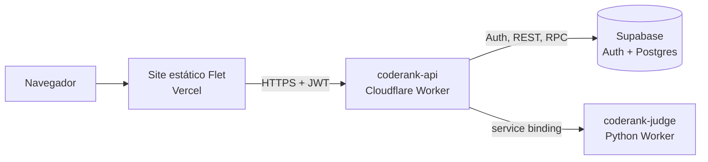

# CodeRank — Plataforma de desafios de programação

<p align="center">
  <a href="https://www.python.org/"></a>
  <a href="https://flet.dev/"></a>
  <a href="https://www.docker.com/"></a>
  <a href="https://github.com/alveslim/CodeRank/actions/workflows/ci.yml"></a>
</p>

O **CodeRank** é um protótipo de plataforma educacional para praticar programação por meio de desafios, editor de código, grupos e ranking. A interface é construída com Flet e o executor local suporta Python e Java em contêineres Docker descartáveis.


## Como funciona



- **Frontend** (`src/`, `main.py`): Flet compilado como site estático (`flet build web`, configurado em `vercel.json`).
- **API** (`api/`): Cloudflare Worker em JavaScript. Cuida de cadastro/login (via Supabase Auth), desafios, submissões, ranking, perfil e grupos. Verifica o JWT do usuário em cada rota protegida.
- **Judge** (`judge/`): Python Worker que executa o código das submissões, um teste por chamada. Não tem segredos nem rota pública; só a API o chama.
- **Banco** (`schema.sql`): Supabase com RLS. Os casos de teste ocultos só são lidos pela API, por funções protegidas por segredo compartilhado. Pontos são concedidos apenas na primeira solução aceita de cada desafio.

### Limites conhecidos

- A execução na web é **somente Python**. Java continua disponível apenas no executor Docker local (`src/services/code_runner.py`).
- No plano **Free** da Cloudflare cada execução tem 10 ms de CPU: solução pesada pode ser cortada como "tempo excedido". No plano pago, defina `TRACE=1` no judge para ligar o limite de 2 s por teste.
- O cadastro envia e-mail de confirmação (configuração padrão do Supabase Auth).
- A sessão é guardada no `localStorage` do navegador.

## Deploy

1. **Supabase**: rode `schema.sql`, insira o segredo (`private.worker_secret`) e carregue os desafios/casos de teste.
2. **Cloudflare**: `cd judge && npx wrangler deploy`; depois `cd api && npx wrangler secret put WORKER_SECRET && npx wrangler deploy`.
3. **Vercel**: importe o repositório; o `vercel.json` já define o build do site Flet.
4. Se a URL da API mudar, ajuste `CODERANK_API_URL` em `src/services/api.py`.

## Executor Docker local (opcional)

O repositório mantém o executor local com Docker (Python e Java), útil para desenvolvimento offline. A interface web usa o judge da Cloudflare.

## Pré-requisitos

- Python 3.13.
- Docker Desktop ou Docker Engine em execução.
- Docker Compose (opcional, para construir as imagens pelo arquivo de composição).

## Configuração local

No PowerShell, a partir da raiz do projeto:

```powershell
python -m venv .venv
.\.venv\Scripts\Activate.ps1
python -m pip install -r requirements.txt

# Constrói as imagens usadas pelo executor
docker compose build

# Inicia a interface
python main.py
```

No Linux/macOS, ative o ambiente com:

```bash
source .venv/bin/activate
```

As imagens são criadas com estes nomes:

- `coderank-python:latest`
- `coderank-java:latest`

Não é necessário iniciar os serviços do Compose: o comando `docker compose build` apenas constrói as imagens. A aplicação cria contêineres efêmeros sob demanda.

## Testes

Os testes unitários não precisam de Docker:

```bash
python -m unittest discover -s tests -v
```

Testes da API e do judge: `cd api && npm test` (Node 22 + Python 3).

A integração contínua também verifica a compilação dos módulos Python e constrói/testa as imagens Python e Java em um runner Linux com Docker.

## Demonstração manual do sandbox

Python:

```bash
printf 'print("sandbox python ok")\n' | docker run --rm -i --network none --read-only --tmpfs /tmp:rw,noexec,nosuid,size=64m coderank-python:latest
```

Java:

```bash
printf '%s\n' 'public class Main { public static void main(String[] args) { System.out.println("sandbox java ok"); } }' | docker run --rm -i --network none --read-only --tmpfs /tmp:rw,noexec,nosuid,size=128m coderank-java:latest
```

## Documentação do produto

O documento do squad reúne escopo proposto, critérios de aceite e cenários BDD. A presença de uma tela no protótipo não significa que a funcionalidade esteja integrada ou concluída.

- [Entregáveis do produto e contrato BDD](docs/ENTREGAVEIS_E_BDD.md)
- [Issues do repositório](https://github.com/alveslim/CodeRank/issues)

