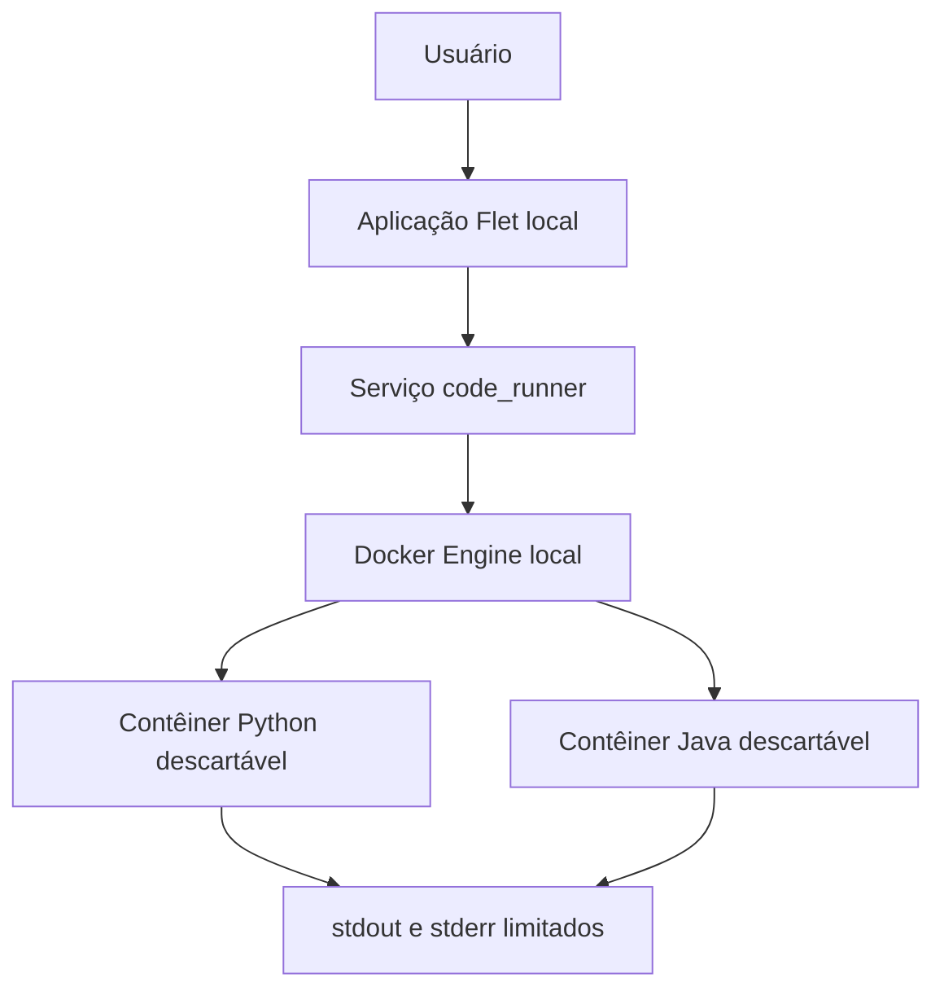

# CodeRank — Plataforma de desafios de programação

<p align="center">
  <a href="https://www.python.org/"></a>
  <a href="https://flet.dev/"></a>
  <a href="https://www.docker.com/"></a>
  <a href="https://github.com/alveslim/CodeRank/actions/workflows/ci.yml"></a>
</p>

O **CodeRank** é um protótipo de plataforma educacional para praticar programação por meio de desafios, editor de código, grupos e ranking. A interface é construída com Flet e o executor local suporta Python e Java em contêineres Docker descartáveis.


## Estado atual do projeto

A branch `main` contém um protótipo funcional de interface e um executor local isolado. Ainda existem funcionalidades demonstrativas que **não devem ser confundidas com serviços prontos para produção**:

- Cadastro e login ainda não estão conectados a um provedor de autenticação.
- Desafios, perfil, histórico, grupos e ranking ainda usam dados locais/estáticos.
- A avaliação automática de submissões com casos de teste e a persistência ainda não foram conectadas na `main`.
- O arquivo `schema.sql` está reservado para a modelagem do banco, mas ainda não contém uma migração.
- O executor Docker é iniciado pela aplicação local. A arquitetura atual não executa contêineres dentro de funções serverless da Vercel.

A interface permite explorar o protótipo sem login. A tela de login informa explicitamente que a autenticação não está integrada.

## Arquitetura atual

A aplicação Flet e o Docker Engine precisam estar disponíveis na máquina em que o CodeRank é executado. Cada submissão é enviada pela entrada padrão para uma imagem previamente construída.



O executor aplica, entre outros controles:

- Rede desabilitada.
- Usuário não privilegiado e remoção de capabilities.
- Sistema de arquivos somente leitura, com `/tmp` temporário limitado.
- Limites de memória, CPU, processos e descritores.
- Timeout de execução e remoção forçada do contêiner.
- Limite de tamanho do código e coleta limitada da saída.

Essas proteções reduzem a superfície de ataque, mas não substituem uma revisão de segurança independente antes de executar código de terceiros em produção.

## Pré-requisitos

- Python 3.13.
- Docker Desktop ou Docker Engine em execução.
- Docker Compose (opcional, para construir as imagens pelo arquivo de composição).

## Configuração local

No PowerShell, a partir da raiz do projeto:

```powershell
python -m venv .venv
.\.venv\Scripts\Activate.ps1
python -m pip install -r requirements.txt

# Constrói as imagens usadas pelo executor
docker compose build

# Inicia a interface
python main.py
```

No Linux/macOS, ative o ambiente com:

```bash
source .venv/bin/activate
```

As imagens são criadas com estes nomes:

- `coderank-python:latest`
- `coderank-java:latest`

Não é necessário iniciar os serviços do Compose: o comando `docker compose build` apenas constrói as imagens. A aplicação cria contêineres efêmeros sob demanda.

## Testes

Os testes unitários não precisam de Docker:

```bash
python -m unittest discover -s tests -v
```

A integração contínua também verifica a compilação dos módulos Python e constrói/testa as imagens Python e Java em um runner Linux com Docker.

## Demonstração manual do sandbox

Python:

```bash
printf 'print("sandbox python ok")\n' | docker run --rm -i --network none --read-only --tmpfs /tmp:rw,noexec,nosuid,size=64m coderank-python:latest
```

Java:

```bash
printf '%s\n' 'public class Main { public static void main(String[] args) { System.out.println("sandbox java ok"); } }' | docker run --rm -i --network none --read-only --tmpfs /tmp:rw,noexec,nosuid,size=128m coderank-java:latest
```

## Documentação do produto

O documento do squad reúne escopo proposto, critérios de aceite e cenários BDD. A presença de uma tela no protótipo não significa que a funcionalidade esteja integrada ou concluída.

- [Entregáveis do produto e contrato BDD](docs/ENTREGAVEIS_E_BDD.md)
- [Issues do repositório](https://github.com/alveslim/CodeRank/issues)

